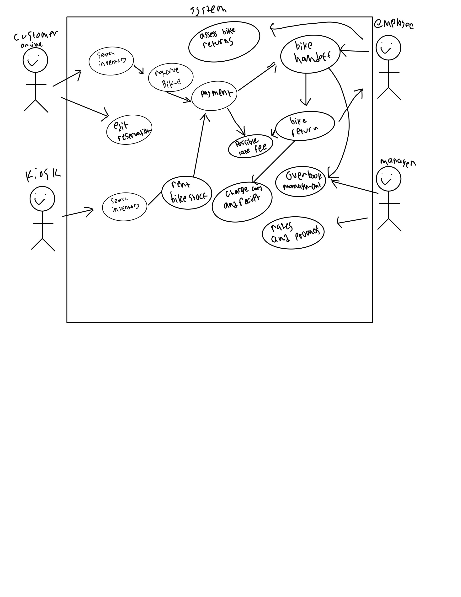

## introduction
> the bend bike shops system is web based with in person kiosks that let customers search for, reserve and pre pay for daily or hourly bike rentals. it has 2 more sides one for employees to manage checking in and out rentals aswell as a managment to oversee pricing inventory and reports.

## user scenario 1
>john is visiting bend for the firtst time and wants to reserve a preformance bike ahead of time. he opens the website and clicks reserve a bike on the home page then goes to the inventory search screen and selects the desired date and filters for preformance bikes and sees some models. he selects the desired bike and adds it to the reservation. the system transitions to the checkout screen and prompts for the credit card and other information to hold the reservation without an imidiate charge. after inputting his information the system verifies the card and shows a confirmation page.

## user scenario 2
>mark is an employee working the front counter on a busy day. a customer walks in returning 2 bikes so he opens the system on the staff side and goes to "bike return". he searches for the rental with the customers phone number and gets the rental details. he inspects the bikes and notes that they were returned 15 minutes late but within the 30 minute grace period so they arent charged a late fee. He selects complete return and the customers get charged and sent a recipt through the system.

## user scenario 3
> todd goes into the shop without a reservation and apporaches a kiosk that displays a welcome prompt "tap to rent a bike" so he taps the screen and it opens the inventory page. he selects his desired bicicle to rent and selects his duration and adds it to his cart. the system advances to the payment info screen and he enters his contact information and is then prompted to swipe his card on the kiosk. the kiosk validates his card and he walks over to the counter to an employee whom he tells his name and they pull his bicycles.

## user scenario 4
> stacy is the store manager during the busy summer. a customer arrives to pickup a bike rental however it was returned damaged and marked out of service. mark working the desk calls stacy and explains the situation to her. stacy logs into the admin part of the system and goes tho the booking managment screen and then finds the affected reservation and reassigns the customers to other bikes and clicks apply override so the system updates the current inventory.

## non goals
* automatic cancellations/inventory reallocation: stock limitations handled by managers
* in app handoff: the software wont support automated stock handoffs staff must be present

## use case diagrams
